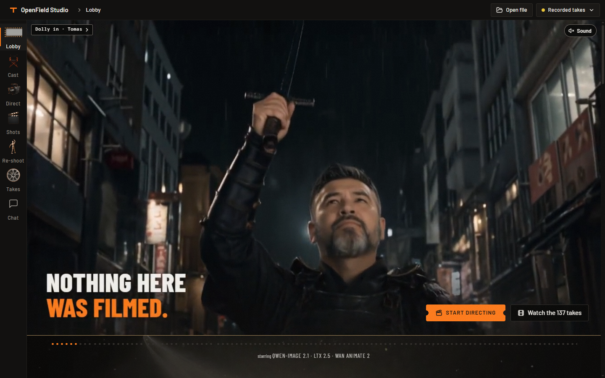
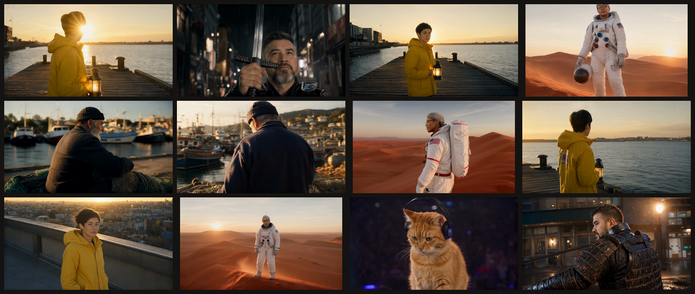
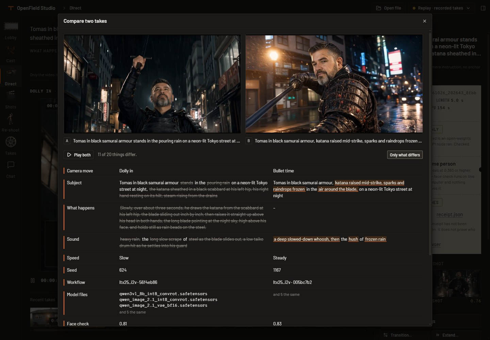

# OpenField Studio

A film studio that runs on open-weights models, with LTX 2.5 for video and sound. Every take keeps a receipt of how it was made.

**[Try it in your browser](https://d0rb.github.io/openfield-studio/)** · **[Watch the two-minute demo](https://d0rb.github.io/openfield-studio/demo.mp4)**



## What you can make

- **Direct.** Describe a shot and pick one of 49 camera moves (44 of 49 hold on a real render): dolly, crane, orbit, crash zoom, bullet time and more. Preview the planned camera before anything renders, and save any take with that camera drawn in a corner, or as a one-page shot sheet.
- **Cast.** Make up a character once, or add photos of someone who agreed, and keep the same face in every shot.
- **Shots.** One still, re-shot as nine camera setups.
- **Re-shoot.** Your dance, a new dancer. Wan Animate 2 keeps the motion and changes the character, or only the face.
- **Edit with words.** Swap the face or the person, change the outfit, relight, remove something, or say the change yourself.
- **Effects.** Rain, lightning and fog, and changes on camera: a person catching fire, turning to gold, a hall falling to ruin.
- **Spoken lines and dubs.** A character says a line in any language. LTX 2.5 writes the voice and the lips together.
- **Transitions, Extend, Loop, Upscale.** Bridge one take into the next (push through is the one style that holds), extend a take, make a loop, or upscale to 2K or 4K.
- **Chat.** Ask an agent to make the film. It uses the studio's own tools and asks before it approves a still.



## How it works

1. You describe the shot and pick a move.
2. Qwen-Image 2.1 renders the still, or the few stills the move needs. They take seconds. You approve them or redo one.
3. LTX 2.5 renders the video from them, with sound.
4. The take is saved with its receipt: the prompts, the seed, the exact workflows with their hash, every model file with its licence and source, the hash of every output file, and the open-weights check that ran before the render.

Renders go through the Comfy Developer Platform (`comfy-sdk`) on the official Comfy templates, with no custom nodes. Before anything is submitted, the studio checks every node and model file against its open-weights list, and it refuses partner nodes and paid APIs.

## Run it

```bash
git clone https://github.com/d0rb/openfield-studio && cd openfield-studio
pip install -e .
openfield demo
```

`demo` opens the app on the 137 recorded takes that ship with the repo, every receipt verified. It needs no GPU and no key.

To render new takes, connect a backend from the app's header. That can be a GPU box you rent (one script sets up an RTX 5090, see [docs/CONNECT.md](docs/CONNECT.md)) or Comfy Cloud with an API key. Every take here was made on rented RTX 5090s. Comfy Cloud uses the same call; a key passed the connection check on October 22, and no take has been rendered there yet.

A 5-second shot costs 2 to 3 cents of GPU time, and a take renders in about two minutes. Each take's receipt records its own GPU time, except the MCP film (tk_20261024_192756_a60e), whose receipt has none. The app shows what a take cost. The 136 takes whose receipts record GPU time took 5.6 GPU hours between them, about $3.97. Failed tries and idle time are not in that figure; one take rendered on October 26 on a box shared with other work, and its receipt counts all 770 seconds of its three runs, including the time the first one spent in the queue.

## Make your own

### Add a camera move

- Add an entry to `_MOVES` in `openfield/engine/rig.py`: `_m(mid, label, group, mode, anchors, phrase, hold, keys)`. The group comes from `GROUPS`; the phrase is the sentence the model reads and `hold` what must stay fixed; the keys are the camera's path as `Pose`s. A `prompt_only` move uses one still (`anchors` is 1), and a `keyframed` move also needs an edit prompt for each still after the first.
- The table checks its own size (`len(MOVES) == 49`) and so do the tests. Raise the number, then run `pytest tests/test_rig.py`.
- The app plays no loop for the move, and `openfield verify` does not count it as tested, until its id is in `VALIDATED`. Add it by hand after a take of the move was checked by eye.

### Add a model

- List the weight file under `models` in `openfield/engine/manifest.json`: its `name`, ComfyUI `directory`, Hugging Face `repo`, `revision`, `path` and `url`, and the `templates` that load it. `scripts/gen_manifest.py` writes that file from the official templates, so an entry made by hand is lost if you run it again.
- Give its repo a licence row. `REPO_LICENSE` in `openfield/engine/models.py` points the repo at a licence in `LICENSES` (add the licence if it is new), and the app cannot build its model list without the row. Then run `python scripts/gen_third_party.py` to rewrite [THIRD_PARTY_MODELS.md](THIRD_PARTY_MODELS.md).
- `openfield verify` counts the file under Models and audits every workflow against the list. A workflow that loads a file that is not in it fails there, and the app refuses to render it.

### Connect a backend

- Press the backend button in the app's header (*Connect a backend…*), choose *GPU box* or *Comfy Cloud*, press *Test*, then *Use this backend*.
- A GPU box needs the address of its comfy-api-proxy, usually `http://127.0.0.1:9189` through an SSH tunnel. Add ComfyUI's own address (`http://127.0.0.1:9188`) and *Test* also checks every model file and node. [docs/CONNECT.md](docs/CONNECT.md) has the setup script, the tunnel, and the command that puts the proxy in front of a ComfyUI you already run.
- Comfy Cloud takes an API key and uses the same call; no take has been rendered there yet.

## If a take fails

The app says why a take stopped. These are six of its messages, as the code prints them.

| What you see | Why | What to do |
|---|---|---|
| **This take did not finish**: `This workflow is not open-weights-only: …` | The graph has a node outside the allowlist taken from the official templates, or a model file the manifest does not list. The message names it: `…: looks like a partner/API node`, `…: not in the allowlist` or `…: not a known open-weights file`. | Use the studio's own workflows. For a model you added, give it a manifest entry and a licence row (see [Make your own](#make-your-own)). |
| In the Connect sheet: `Missing: <file> (models/<directory>, from <repo>)` and `<n> of 6 workflows ready; <m> model file(s) missing` | The box's ComfyUI does not have that file. *Test* checks this when it is given ComfyUI's address. | Run the line printed after *On the box:* (`FETCH_ONLY=<group> bash /workspace/pod_setup.sh fetch`, with `HF_TOKEN` set for gated files), then press *Test* again. |
| `Not connected: GPU box at <host>`, or on a take `Could not reach the server. Is the tunnel up?` | The app could not open a connection to the proxy address. | Start the SSH tunnel again, then press *Test*. |
| **Not in this recording**: `This exact recipe was not rendered, and Replay never fakes a result. …` On the hosted copy a notice says `This hosted copy replays recorded takes. Install OpenField and connect Comfy Cloud or a GPU box to render new ones.` | The backend is Replay. It plays recorded takes and nothing else, and nobody rendered this recipe. | Press *Go to a recording*, or connect a backend and render it. On the hosted copy, install OpenField first. |
| **This take did not finish** with `The job failed…` or `The render took longer than …s and was cancelled.`, or **Canceled**: `You canceled this take before it finished.` | The box reported an error, the render ran past its time limit, or you canceled it. | Press *Edit and try again* to load the take's settings back into the form, or *Remove* to clear it. |
| `Checksum does not match` on a take's receipt, or `Checked in this browser just now: receipt.json does not match its seal.` | The receipt was edited after it was written, or OpenField did not make it. | Run `openfield verify`: it names the first take that fails (`first failure: <take id>`). Restore that take from the repo, or treat it as edited. |

## Talk to it

The Chat room puts an agent in charge of the studio. By default that is OpenCode with an open-weights model. Claude Code and Codex work too. The agent gets the studio's tools and nothing else, each chat has a render cap, and it asks before it approves stills.

`openfield mcp` gives the same 24 tools to any MCP client, and `skills/openfield-director/SKILL.md` teaches a coding agent how to use them well. On October 24 a Claude Code session made a three-shot film through it. On October 25 OpenCode with DeepSeek made a take through the Chat room on a rented GPU. More in [docs/MCP.md](docs/MCP.md).

Rendering never calls a closed API. The agent is optional: by default the Chat room talks to OpenCode with an open-weights model, and whichever agent asks, the open-weights check runs before every render.

## Check it

- **In the app.** Open a take and press *Check it in this browser*. Your browser hashes the receipt again and compares it with its seal.
- **Side by side.** *Compare…* plays a take next to another one and lists what their receipts say differently, down to the words that changed.
- **On the command line.** `openfield verify` checks the workflows, every receipt, the model files and the counts:

```text
[ ok ] Workflows: 6/6 templates pass
[ ok ] Receipts: 137 take(s), 137 seal(s) verified
[ ok ] Models: 17 model file(s), all open-weights
[ ok ] Proof counts: moves 44/49, angles 65/96, effects 21/21, quality 3/3, from-image yes, single-pass on
[ ok ] Replay: refused an unrecorded recipe

VERIFIED: 5 ok, 0 failed
```

- **By hand.** Each take folder holds the workflows it ran, as JSON you can load in ComfyUI.

A receipt is a checksum, so it shows edits. It does not prove who made the file. [docs/EVIDENCE.md](docs/EVIDENCE.md) lists what was rendered, what held, what did not, and how each one was judged.

The hosted copy plays recorded takes only. Change a recipe there and it says it cannot render it, instead of inventing a take.



## What does not work yet

- 5 of the 49 moves did not hold on a real render: arc left, arc right, orbit 360, rack focus and pedestal down. The app plays no loop for them. On October 26 two more held for the first time: through object, made as its reverse (a dolly out from just inside the door, played backwards), and the dolly zoom, made as a dolly out with a window that follows the face and keeps it at its size. Pedestal down made as its reverse still pulled back, and the keyframed arcs still turned the subject, so those stay off until a render holds.
- 65 of the 96 camera positions hold on a still. A shot that starts from a re-angled still drifts away from the angle.
- Of the four transition styles, only the push holds.
- Comfy Cloud: a key passed the connection check on October 22 (authenticated, ready); no take has been rendered there yet.

## Models

| Model | Used for | Licence |
|---|---|---|
| LTX 2.5 (Lightricks) | video with sound | LTX-2.x Community License (free under $10M annual revenue) |
| Qwen-Image 2.1 | stills and edits | Qwen Research License (non-commercial, "Built with Qwen") |
| Wan Animate 2 | motion transfer | Apache-2.0 |
| Real-ESRGAN x4plus | upscale | BSD-3-Clause |
| YuNet, SFace | the local face check | MIT, Apache-2.0 |

Each model keeps its own licence. The details are in [THIRD_PARTY_MODELS.md](THIRD_PARTY_MODELS.md).

## More

- [Using the app](docs/USING.md)
- [What was tested, and how](docs/EVIDENCE.md)
- [Connect a GPU](docs/CONNECT.md) and [the GPU box in detail](docs/POD.md)
- [Agents and MCP](docs/MCP.md)
- [How it is built](docs/HOW_IT_IS_BUILT.md), [the SDK path](docs/SDK.md) and [render times](docs/benchmarks.md)
- [Safety and consent](docs/SAFETY.md) and [working on the code](docs/DEVELOP.md)

The code is under the [MIT licence](LICENSE). Model weights are not included. Built with Qwen.
