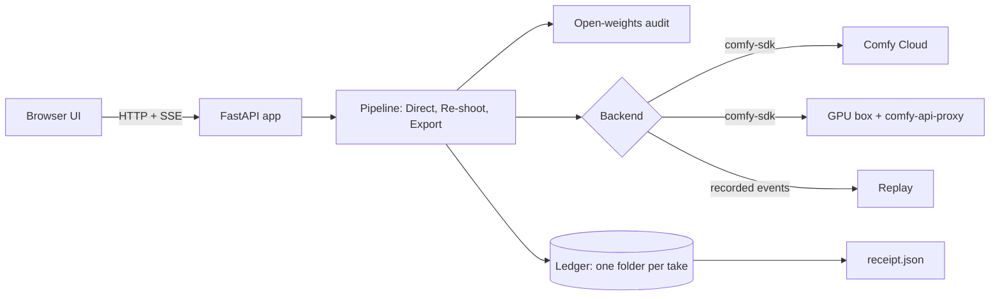

# OpenField Studio

**Cast a character. Direct the shot. Re-shoot a clip. Every take comes with a receipt.**

An open-weights film studio built on the [Comfy Developer Platform](https://comfy.org/open-source-higgsfield).
LTX 2.5, Qwen-Image 2.1 and Wan Animate 2 run on Comfy Cloud or on a GPU you rent, driven through the
official `comfy-sdk`. A virtual camera rig turns "slow dolly in" into shots you can approve before the
expensive video render, and each finished take carries a sealed receipt (prompts, seeds, workflow, exact
model files and licences) that you can drop back in to remix it.

<!-- TODO(hero): the Re-shoot before/after clip, then the 9:16 export (docs/media/hero.mp4 and a poster) -->
<!-- TODO(try-it-link): the hosted Replay URL, once published -->

Made for the Comfy "Open Source Higgsfield" challenge. Inspired by Higgsfield's product ideas; original code,
copy and design, not affiliated with Higgsfield.

## Quick start

Python 3.10 or newer.

```bash
pip install -e .
openfield doctor     # checks Python, ffmpeg, the Comfy SDK, your render target, workflows and recorded takes
openfield demo       # opens the app on recorded takes: no key, no GPU
```

`demo` is **Replay**: it plays real takes that were rendered earlier, with their events, receipts and
identity scores. It never renders and never fakes a result. Change the recipe and it tells you so, because
nothing was rendered for it. To render your own takes, connect a backend (next section).

## Render for real

The same app runs against three targets; the only switch is two environment variables
(copy `.env.example` to `.env`).

| Target | `COMFY_BASE_URL` | `COMFY_API_KEY` |
|---|---|---|
| Comfy Cloud | unset | your Comfy API key |
| A GPU box running ComfyUI and `comfy-api-proxy` | `http://127.0.0.1:9189` (SSH tunnel) | none on loopback |
| A Comfy API deployment | the deployment URL | your key |

Setting up a rented GPU is one script, and the model download is large: see [docs/POD.md](docs/POD.md). Then:

```bash
openfield doctor     # confirms the target answers
openfield serve --open
```

## Commands

| Command | What it does |
|---|---|
| `openfield demo` | The app on recorded takes (Replay). No key, no GPU. |
| `openfield serve` | The app on your configured Comfy target. |
| `openfield doctor [--fetch-models]` | Checks the machine and the target; downloads the 38 MB face-check models. |
| `openfield audit FILE` | The open-weights audit of any API-format workflow. |
| `openfield showcase` | Renders the showcase spec on a real backend (`--dry-run` to see the plan). |
| `openfield export-static` | Builds the hosted Replay as plain files. |

## What you can do

| Station | What it does | Model |
|---|---|---|
| **Cast** | Keep reference images for a character or product, or generate an invented character from a description and keep the candidate you like. A local face check shows what the identity check can use. Consent is required before a cast is saved. | Qwen-Image 2.1; face check: YuNet + SFace (local) |
| **Direct** | Describe a subject, set a camera rig, pick a move. Approve cheap stills, then render the shot with synced sound. | Qwen-Image 2.1, LTX 2.5 |
| **Re-shoot** | Take a clip you filmed and one reference image. Get the same motion with a new character. Before/after comparator, one-click 9:16. | Wan Animate 2 |
| **Takes** | Every render is a folder: video, stills, events, workflows, receipt. Export 16:9, 9:16 or a reel of several takes. Open any take's exact graph in ComfyUI. | ffmpeg |

### The camera rig

35 moves in 7 groups (lock and aim, dolly and push, zoom and focus, orbit and arc, track and truck, crane
and altitude, handheld and story). A move is either **keyframed** (the rig plans one to five still frames
along the path, you approve them, and LTX 2.5 renders between them) or **prompt-only** (one approved still
and a precise camera instruction). Quick mode renders any keyframed move the second way: cheaper, with no
anchor stills to approve. Twelve moves are promoted in the interface. A move is marked validated only after a
real render exists for it; the showcase shows which.

### Using the interface

The layout is the familiar one for this kind of tool: stations on the left, a prompt bar over a large Monitor, a
strip of recent takes, and a settings panel on the right. Press Shoot and the Monitor shows the render step by step;
the stills stop for your approval before any video is rendered. Pick a take and its **Take** tab shows the identity
result, the open-weights audit, the receipt, and the actions: use its settings again, copy a remix link, open its
graphs in ComfyUI, export 9:16.

| Key | Does |
|---|---|
| Ctrl or Cmd + Enter | Shoot from the prompt (Recreate, in Replay) |
| Arrow keys | On the Move Pad: the next move. On the Monitor: one frame back or forward when paused, one second when playing |
| Space | Play or pause the Monitor |
| `[` | Hide or show the settings panel |

It works with the keyboard alone, keeps AA contrast, respects `prefers-reduced-motion`, and folds down to a phone
layout. In Replay, anything you change that was not recorded turns Shoot into "Needs a backend" instead of faking a render.

## How it uses the Comfy Developer Platform

OpenField never talks to ComfyUI directly. The whole render path is `comfy-sdk`:

```python
from comfy_sdk import AsyncComfy

async with AsyncComfy() as client:                       # target chosen by COMFY_BASE_URL / COMFY_API_KEY
    wf = client.workflows.from_json(graph)               # an API-format graph, patched from an official template
    frame = client.assets.from_file("first_frame.png")
    wf.set_input(slots["first_frame"]["node"], "image", frame)   # node ids come from the template's slot map
    job = await client.submit(wf)                        # inputs are uploaded here
    async for event in job.events():                     # progress, previews, queue position
        ...
    await job.wait()
    output = job.get_outputs(slots["output"]["node"])[0]
    await output.to_file("take.mp4")
```

(The real code is [openfield/backends/sdk.py](openfield/backends/sdk.py); it adds timeouts, cancellation,
error mapping and event recording.)



Workflows are the **official ComfyUI templates**, exported in API format and patched in place: the patcher
checks every node, input and slot before it touches the graph, snaps sizes to what each model accepts (and
records the snapped value), removes the templates' prompt enhancers so the exact prompt sent is the one recorded, and
refuses anything unexpected. No custom nodes. The graphs for each render step are saved with the take, so
"Open in ComfyUI" opens exactly what ran. Details and checks: [openfield/workflows/README.md](openfield/workflows/README.md).

## Open weights, enforced

Before any workflow is submitted, the audit checks every node class against an allowlist taken from the
official templates and every model file against the registry in
[THIRD_PARTY_MODELS.md](THIRD_PARTY_MODELS.md). Partner nodes and paid APIs are not in the allowlist, so
they cannot run. The result is stored in each take's receipt.

```bash
openfield audit path/to/workflow.api.json
```

| Model | Used for | Licence (check the model card) |
|---|---|---|
| LTX 2.5 (Lightricks), with its Gemma 4 text encoder | video with synced audio | LTX-2.x Community License: free under $10M annual revenue; gated download |
| Qwen-Image 2.1 | stills | Qwen Research License: non-commercial, "Built with Qwen" |
| Wan Animate 2 | motion transfer | Apache-2.0 |
| Gemma 4 e2b (Comfy-Org repack) | not used: the LTX templates list it for a prompt-enhancer that OpenField removes | Apache-2.0 |
| YuNet, SFace | local face check | MIT, Apache-2.0 |

"Open weights" is not "open source": each model keeps its own licence. The still-image step is a swappable
slot so a different licence is one template away.

## Receipts and Remix

Each take stores `receipt.json` next to the video: the recipe (subject, rig, move, seeds), the final prompts,
the workflow hashes and SDK job ids, the exact model files with licences, the audit result, identity scores
and an AI-generated disclosure. A SHA-256 over the canonical JSON makes edits detectable (it is a checksum,
not a signature). The receipt is also embedded in the video, its poster image and generated-character stills, so
**Remix** accepts those files themselves; social sites strip metadata, so the sidecar and the recipe link are the
reliable path.

## Identity check

Cast references are compared with every generated still, every rendered shot (its middle frame) and the Re-shoot result
using YuNet detection and SFace embeddings
(cosine similarity, threshold 0.363, the same-identity boundary from the SFace model card). It reports a
score, re-rolls a drifting still once (a rendered shot is reported, never re-rendered), and says **n/a** when there is
no real face (stylised, product or faceless shots). It is a consistency aid, not proof of identity, and it never reads a missing model as a match.

## Hosted Replay

`openfield export-static --out site` writes the app and its recorded takes as plain files, with no server and
no key, that any static host can serve. The browser plays each take's recorded events back; every edit is
refused with an explanation, exactly as local Replay does.

<!-- TODO(benchmarks): render times per step on a rented GPU and on Comfy Cloud, from docs/benchmarks.md -->

## Reproduce the showcase

The recorded takes were rendered from [showcase/spec.json](showcase/spec.json) with one command against a real backend:

```bash
openfield showcase --dry-run     # validate the spec and list every render
openfield showcase               # render it (COMFY_BASE_URL or COMFY_API_KEY must be set)
```

Characters are generated from text, so they are invented and reproducible; the re-shoots use a short clip filmed for
this project. See [showcase/README.md](showcase/README.md), including the keyframing experiment that decides which camera
moves are marked validated.

## Develop

```bash
pip install -e ".[dev]"
ruff check .
pytest                                  # a faithful fake of the Comfy API stands in for the GPU; also drives the
                                        # real interface in Chrome or Edge (skipped when Node or a browser is missing)
node --test "tests/js/*.test.mjs"       # front-end logic
python scripts/dev_fake_stack.py        # the app on that fake, for UI work (its output is labelled FAKE, never a render)
python scripts/record_demo.py --url URL # the demo video, scripted; see docs/DEMO.md
python scripts/release_check.py         # the pre-publish gate
```

```
openfield/engine/     rig, workflow patcher, audit, receipts, identity, video
openfield/backends/   comfy-sdk backend, replay backend
openfield/            pipeline, ledger, cast, exports, showcase, app (FastAPI), cli
openfield/workflows/  the five exported ComfyUI graphs and their slot maps
openfield/web/        the interface: static ES modules and plain CSS, self-hosted Inter and Lucide icons, no build step (about 66 KB of script over the wire)
scripts/              GPU box setup, template export and validation, release gate
showcase/             the specs the recorded takes were rendered from
tests/                Python tests, JS tests, a faithful fake of the Comfy API
```

## Safety and provenance

- Reference images need a consent choice (my own, with consent, or fictional). Do not upload people who have not
  agreed, and do not use the studio for deception: receipts mark every output as AI-generated.
- Output is for lawful, safe-for-work use. A plain content guard refuses prompts that ask for explicit sexual
  content, graphic gore or self-harm before anything reaches a model. It is a good-faith filter, not moderation:
  it cannot recognise a real person's name, so characters must be invented or consented to.
- The bundled showcase uses fictional characters and original footage.
- The interface ships Inter (SIL Open Font License 1.1) and a selection of Lucide icons (ISC); their licences sit
  next to them in `openfield/web/fonts/` and `openfield/web/icons/`. The workflows are the official ComfyUI
  templates (MIT); see `openfield/workflows/LICENSE.workflow_templates`.
- This project was built with an AI coding assistant (Claude Code) under human direction, including
  independent review passes of the plan and the code.

## Licence

Code: [MIT](LICENSE). Model weights are not included and keep their own licences
([THIRD_PARTY_MODELS.md](THIRD_PARTY_MODELS.md)). Images produced with Qwen-Image 2.1 must show "Built with Qwen"
where its licence requires it.
