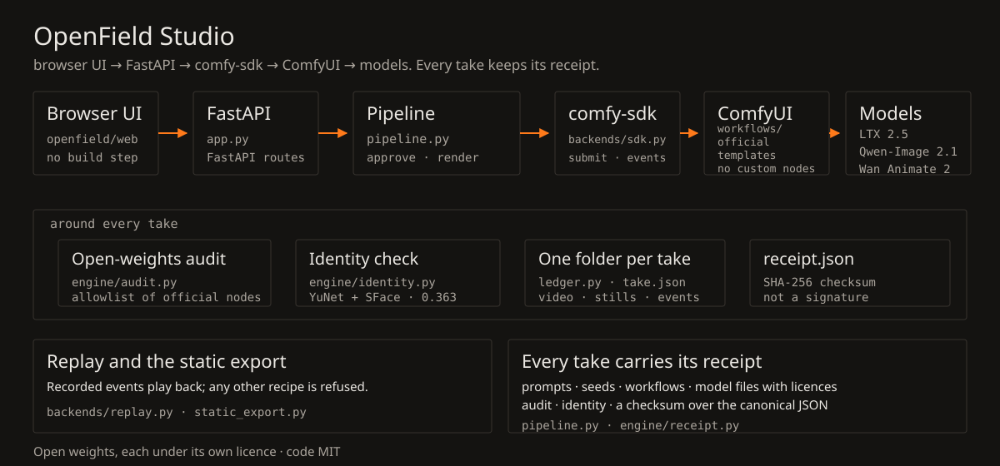

# How it is built

OpenField Studio is a small web app in front of a strict render pipeline. The browser never talks to ComfyUI. It asks the FastAPI app for a plan, the app hands the work to a pipeline, and the pipeline speaks to ComfyUI only through `comfy-sdk`. The same pipeline writes a receipt for every take, so you can check what ran later. This page follows that path and names the file for each step.

## The browser and the app

The interface is static: ES modules and plain CSS under `openfield/web/`, self-hosted fonts and icons, no build step (`openfield/web/index.html`). It holds the screen state and talks HTTP plus Server-Sent Events to the FastAPI app.

`create_app` in `openfield/app.py` wires the routes and serves the web folder at the end. The endpoints a take uses are small. `POST /api/direct/plan` returns the compiled plan, `POST /api/takes/direct` and `POST /api/takes/reshoot` start work, `/api/takes/{id}/approve` releases approved stills, and `/api/takes/{id}/events` streams progress. Nothing there decides which model runs. The pipeline does that.

## The pipeline

`openfield/pipeline.py` is the stage machine. `start_direct` validates the recipe and compiles a `ShotPlan`. A keyframed move becomes a hero still plus one to four edited anchors (two to five stills in all). `_run_direct` renders the hero, edits the anchors, waits for approval, then asks LTX 2.5 to render the segments between them.

`start_reshoot` and `_run_reshoot` take one clip and one reference image to Wan Animate 2. A portrait request generates a few Qwen-Image 2.1 candidates for a Cast.

A Direct take can also start from the person's own still (`DirectRequest.source`). `_fit_source` fits the image to the still size and keeps it as `inputs/hero.png`, and nothing is rendered for it. The take carries a quality tier (`openfield/engine/quality.py`): still and video sizes plus Qwen still steps, the only numbers a tier may change.

`Pipeline.estimate_direct` answers the plan line's time from this install's own `run.json` timings of same-shaped takes on the connected backend, or with nothing. Every model call goes through `_run`. Before it submits, it patches the template and audits the result. A graph that fails the allowlist raises `audit_failed` and never reaches the backend.

Each step gets its own folder in the ledger (`openfield/ledger.py`), with the workflow graph, events and media, so the next step can use the previous output and the take can be inspected later.

## comfy-sdk and ComfyUI

`openfield/backends/sdk.py` builds the backend from `COMFY_BASE_URL` and `COMFY_API_KEY`, or from the address and key the Connect sheet sends to `AppState.connect` in `openfield/app.py`. A test probes a candidate without switching. A remembered connection keeps the address, never the key. Its `health` tells a proxy from a bare ComfyUI.

`openfield/engine/preflight.py` reads ComfyUI's own `/object_info` to report, per workflow, the model files and node classes a box lacks. Inside `run` it constructs an `AsyncComfy` client, loads the patched graph, uploads the stills or the source clip as assets, submits the job, forwards progress events, waits, then downloads the chosen output.

Timeouts, cancellation and the SDK's error classes are mapped to messages a person can act on. The recorded events go into the take folder.

ComfyUI itself runs Comfy's **official templates**. `openfield/workflows/` holds the six exported API graphs and a slot map for each. They come from `Comfy-Org/workflow_templates` at the commit pinned in `openfield/engine/manifest.json` (`openfield/workflows/README.md`). The patcher in `openfield/engine/workflows.py` checks every node and input before touching the graph. It sets only the named slots, removes the templates' prompt enhancers and unused wiring, and prunes what no longer feeds an output. No custom nodes.

The model files those graphs name are LTX 2.5 (video and audio), Qwen-Image 2.1 (stills) and Wan Animate 2 (motion transfer). The open-weights audit checks them against the registry in `THIRD_PARTY_MODELS.md`.

## The checks around a take

The **audit** (`openfield/engine/audit.py`) compares every node class with the allowlist generated from the official templates (`openfield/engine/models.py`) and every weight file with the model registry. Partner and API nodes are not in the allowlist, so they fail. The result is stored in the receipt and shown in the interface.

The **identity check** (`openfield/engine/identity.py`) compares the Cast references with generated stills and with frames from a rendered shot. It uses YuNet for detection and SFace embeddings at the 0.363 cosine boundary. A drifting still is re-rolled once. A rendered shot is reported, never re-rendered. It is a consistency aid. It does not prove identity.

The **receipt** is assembled at the end of a take (`openfield/pipeline.py`): recipe, prompts, seeds, workflow hashes, model files and licences, audit result, identity scores and a disclosure. `receipt.seal` hashes the canonical JSON and embeds the result in the video and the poster, with a sidecar next to them. `receipt.verify` (`openfield/engine/receipt.py`) checks that digest.

It is a checksum. It carries no signature.

## Replay and the static export

`openfield/backends/replay.py` is the backend with no key and no GPU. It indexes recorded takes by recipe fingerprint and plays their recorded events. `run` always refuses a new render, because nothing was rendered for a changed recipe. The pipeline marks such takes as replays (`openfield/pipeline.py`) so the interface can say so.

`openfield/static_export.py` turns the same setup into plain files: the web app, a manifest, and one folder per recorded take with its receipt, events, media, stills and workflows. `openfield/cli.py` is the command. There is no server-side render path in that export. The browser plays the recorded events back and refuses an unrecorded recipe, exactly as local Replay does.

## Read it yourself

- [openfield/app.py](../openfield/app.py): the HTTP surface.
- [openfield/pipeline.py](../openfield/pipeline.py): Direct, Re-shoot, approval, audit and receipts.
- [openfield/backends/sdk.py](../openfield/backends/sdk.py) and [replay.py](../openfield/backends/replay.py): the two ways a take can run.
- [openfield/engine/](../openfield/engine/): rig, patcher, audit, models, identity, receipts, video.
- [openfield/workflows/README.md](../openfield/workflows/README.md): where the graphs come from and how they are checked.
